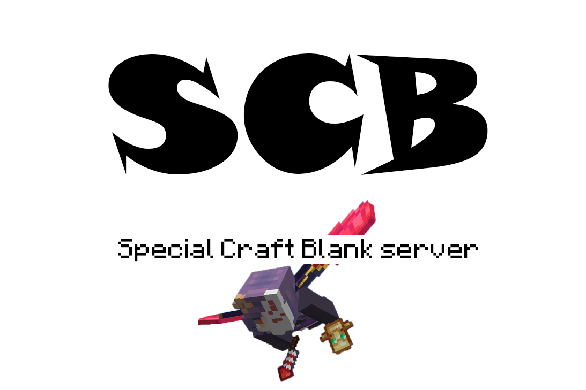
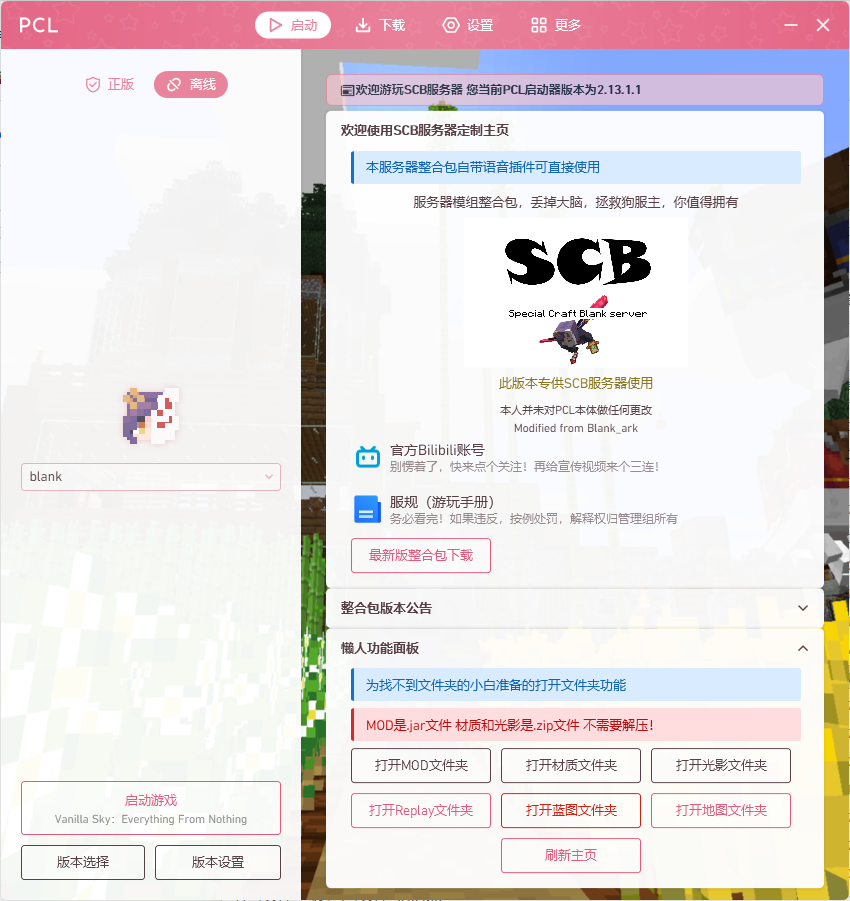

<div align="center">

# PCL2 自定义主页 · SCB

**给 Minecraft 服务器用的 PCL2 启动器主页：欢迎卡片 + 整合包公告 + 懒人功能面板**

一个 `Custom.xaml` 搞定，不改 PCL 本体，不需要装任何东西。

[](https://creativecommons.org/licenses/by-nc-sa/4.0/)
[](#快速开始)
[](#快速开始)



</div>

---

## 目录

- [这是什么](#这是什么)
- [界面长什么样](#界面长什么样)
- [快速开始](#快速开始)
- [文件说明](#文件说明)
- [改成你自己的服务器](#改成你自己的服务器)
- [常见问题](#常见问题)
- [联网更新是怎么工作的](#联网更新是怎么工作的)
- [本次整理改了什么](#本次整理改了什么)
- [致谢与协议](#致谢与协议)

## 这是什么

一份给 Minecraft 服务器玩家看的 PCL2 自定义主页，把新玩家最常问的三件事直接摆在启动器首页：

| 玩家的问题 | 主页给出的答案 |
| --- | --- |
| 这是什么服？好玩吗？ | 主卡片：欢迎语 + 抬头文案 + 社区图 |
| 装了什么模组？更新到哪了？ | 整合包版本公告卡片：版本号 + 更新内容 |
| 「mods 文件夹在哪啊？」 | 懒人功能面板：一键打开 MOD / 材质 / 光影 / 回放 / 蓝图 / 存档文件夹 |

### 特点

- **零依赖**：只需要一个 `Custom.xaml`，不用装插件，也不改 PCL 本体
- **联网更新**：改一次文件，所有玩家的主页自动更新。这是 PCL 原生能力，靠版本号判断要不要重新下载
- **对小白友好**：把「找不到文件夹」这件事从群聊里删掉，顺手把 TeamSpeak 安装包也备好
- **可整活**：欢迎语、公告、表情包随便换，改的都是纯文本
- **有据可查**：所有事件类型、替换标记的写法都对着 PCL 内置帮助和官方 Wiki 核对过，见 [docs/customize.md](docs/customize.md)

## 界面长什么样

```
┌───────────────────────────────────────────────────────────────┐
│ 📰 欢迎游玩 XXX          您当前PCL启动器版本为 2.12.6          │ ← 半透明提示条
├───────────────────────────────────────────────────────────────┤
│ 欢迎使用Blank制作的自定义主页                                  │ ← 主卡片（不可折叠）
│   ⓘ 将自定义PCL2主页从本地改为了可联网更新                     │
│          服务器模组整合包，丢掉大脑，拯救狗服主，你值得拥有      │
│                      [ 社区 LOGO ]                            │
│                此版本专供 XXX 服务器使用                       │
│   ▸ 官方Bilibili账号      别愣着了，快来点个关注！              │
│   ▸ 本服TS服务器地址和密码  肥肠之好用的语音软件……              │
│   ▸ 服规（游玩手册）        务必看完！……                       │
├───────────────────────────────────────────────────────────────┤
│ 整合包版本公告                                           ⌄     │ ← 默认折叠
│   当前版本为 2.1.0 测试版 / 更新了所有模组和加载器前置运行库……  │
├───────────────────────────────────────────────────────────────┤
│ 懒人功能面板                                             ⌄     │ ← 默认折叠
│   ⚠ MOD是.jar文件 材质和光影是.zip文件 不需要解压！            │
│   [打开MOD文件夹] [打开材质文件夹] [打开光影文件夹]             │
│   [打开Replay文件夹] [打开蓝图文件夹] [打开地图文件夹]          │
│   [下载TeamSpeak 3] [下载TS3汉化] [刷新主页]                    │
└───────────────────────────────────────────────────────────────┘
```

[主页预览](assets/preview.png)

## 快速开始

> **前置条件**：Windows + PCL2。自定义主页的入口在 `设置 → 个性化 → 主页`。

### 方式一：读取本地文件（自己玩、调试用）

1. 下载本仓库的 [`Custom.xaml`](Custom.xaml)
2. 放进 **PCL 所在文件夹** 的 `PCL` 子文件夹：`<PCL 所在文件夹>\PCL\Custom.xaml`
   - 怕找错？在 PCL 里点 `设置 → 个性化 → 主页 → 打开主页文件夹`，把文件丢进去就行
   - 注意是 `PCL` 文件夹（和 `settings.ini` 在一起），**不是** `.minecraft` 文件夹
3. PCL 里选 `读取本地文件`
4. 点 `刷新主页`，或按 F5

> 小技巧：直接把 `Custom.xaml` 拖进 PCL 窗口也能加载。

### 方式二：联网更新（服务器服主推荐）

1. 把 `Custom.xaml` 和 `Custom.xaml.ini` **一起**放到支持直链下载的地方（本仓库、图床、CDN 都行）
2. PCL 里选 `联网更新`，填入 `Custom.xaml` 的直链，例如：

   ```
   https://cdn.jsdelivr.net/gh/BlankTasftu/pcl2-custom-homepage@main/Custom.xaml
   ```

3. 以后更新主页：改内容 → 把 `Custom.xaml.ini` 里的版本号往上加 → 提交。玩家的 PCL 下次刷新就会自动拉到新版

原理、直链怎么选、缓存怎么清，见 [docs/publish.md](docs/publish.md)。

## 文件说明

| 文件 | 作用 |
| --- | --- |
| [`Custom.xaml`](Custom.xaml) | 主页本体。PCL 读取它并渲染出整个界面 |
| [`Custom.xaml.ini`](Custom.xaml.ini) | 联网更新的**版本标记**，内容就一行 `V 0.0.5`。PCL 会把下载地址里的 `.xaml` 换成 `.xaml.ini` 去取它：版本没变就用本地缓存，变了才重新下载整份主页 |
| [`docs/customize.md`](docs/customize.md) | 逐项自定义教程：12 处占位符对照表、自定义事件语法、替换标记速查 |
| [`docs/publish.md`](docs/publish.md) | 联网更新原理、发版流程、图片托管、投稿到 PCL 官方主页预设 |
| [`assets/`](assets) | 主页用到的两张图（GitCode release 的本地备份） |
| [`CHANGELOG.md`](CHANGELOG.md) | 更新日志 |

## 改成你自己的服务器

打开 `Custom.xaml`，按 `【改我】` 注释找就行，一共 12 处：

| # | 想改什么 | 在哪 | 怎么改 |
| --- | --- | --- | --- |
| 1 | 服务器名称（顶部提示条） | 区块 1 | `📰欢迎游玩XXX` 里的 `XXX` |
| 2 | 主页大标题 | 区块 2 的 `MyCard` `Title` | 现在是「欢迎使用Blank制作的自定义主页」 |
| 3 | 抬头文案 | 区块 2 第 2 个 `TextBlock` | 现在是「服务器模组整合包，丢掉大脑……」 |
| 4 | 发布声明 | 区块 2 | `此版本专供XXX服务器使用` |
| 5 | Bilibili 账号 | 区块 2 第 1 个 `MyListItem` | 账号注册好后：`EventType="弹出窗口"` 改成 `EventType="打开网页"`，`EventData` 填账号主页地址 |
| 6 | TS 服务器地址与密码 | 区块 2 第 2 个 `MyListItem` | `EventData="标题\|内容"`，内容里换行写 `\n` |
| 7 | 服规文档链接 | 区块 2 第 3 个 `MyListItem` | 换掉 `EventData` 里的腾讯文档地址 |
| 8 | 整合包版本公告 | 区块 3 | 直接改那几行 `TextBlock` 的文字 |
| 9 | 6 个文件夹按钮指向的文件夹 | 区块 4 | 已经用 `{version_indie}` 替换标记，换整合包、改版本名都不用动；要打开别的文件夹就改竖线后面那一截 |
| 10 | 两张图（LOGO、表情包） | 区块 2 / 区块 3 的 `Image` | 换 `Source` 为图片直链；也可以用本仓库 `assets/` 的 raw 地址 |

### 懒人面板的路径怎么写

6 个按钮都用 PCL 的**替换标记**拼路径，所以换整合包、改版本名、开不开版本隔离都不用改：

| 按钮 | 实际写法 |
| --- | --- |
| 打开 MOD 文件夹 | `explorer\|&quot;{version_indie}mods&quot;` |
| 打开材质文件夹 | `explorer\|&quot;{version_indie}resourcepacks&quot;` |
| 打开光影文件夹 | `explorer\|&quot;{version_indie}shaderpacks&quot;` |
| 打开 Replay 文件夹 | `explorer\|&quot;{version_indie}replay_recordings&quot;` |
| 打开蓝图文件夹 | `explorer\|&quot;{version_indie}schematics&quot;` |
| 打开地图文件夹 | `explorer\|&quot;{version_indie}saves&quot;` |

`{version_indie}` 会被 PCL 替换成「当前选中版本的文件夹」（开了版本隔离）或「.minecraft 文件夹」（没开），末尾自带反斜杠。想打开别的文件夹，把后面那个名字换掉就行。

三个容易踩的点：

- **竖线不能省**：`EventData` 的格式是「命令|参数」。少了 `|`，PCL 会把整串当成程序路径去找，点击必定失败
- **路径两头加 `&quot;`**：路径里可能有空格（比如版本文件夹叫 `SCB 1.20.1 Fabric`），加引号能避免打开失败，PCL 官方也这么建议
- **PCL 版本太老时**：如果按钮点了没反应且日志报「执行失败」，说明你的 PCL 不认识这个标记，把路径改回写死的完整路径即可，例如 `explorer\| D:\Minecraft\.minecraft\mods`

更多替换标记（版本号、玩家名、日期、自定义变量……）见 [docs/customize.md](docs/customize.md#替换标记速查)。

## 常见问题

**Q：点「打开 MOD 文件夹」弹出「执行确认」窗口？**
这是 PCL 的安全机制：自定义主页里的 `执行命令` 事件首次运行需要玩家确认。选「继续且今后不再要求确认」即可，之后不会再弹。

**Q：文件夹按钮点了没反应，日志提示执行失败？**
按顺序排查：① 当前没有选中任何版本，`{version_indie}` 会被替换成空；② 你的 PCL 版本不认识这个替换标记，改回写死的完整路径即可；③ 「执行确认」窗口被点了取消。细节见上面「懒人面板的路径怎么写」。

**Q：两张图（LOGO、表情包）不显示？**
图片走的是 GitCode release 直链，需要能联网访问 GitCode。本仓库 `assets/` 里有备份，想彻底自给自足可以换成自己的图床直链。

**Q：改完文件，主页没变化？**
- 本地文件模式：点 `刷新主页` 或按 F5
- 联网更新模式：PCL 只认 `Custom.xaml.ini` 里的版本号。**内容改了但版本号没改，玩家会一直用缓存**。改内容时记得同时把版本号 +1

**Q：联网更新填了地址却拉不到？**
- 地址要以 `.xaml` 结尾（PCL 靠把 `.xaml` 换成 `.xaml.ini` 来取版本号）
- 必须是**直接返回文件内容**的直链，不能是网页
- GitHub 的 `raw.githubusercontent.com` 在国内经常连不上，建议换成 jsDelivr 之类的 CDN，或用 GitCode / Gitee 的 raw 地址

**Q：深色主题下顶部提示条的文字看不清？**
v1.0.4 已修：文字颜色从写死的 `#FF000000`（纯黑）改成主题画刷 `{DynamicResource ColorBrush1}`，会跟着 PCL 的主题色走。手里如果是旧版文件，按这一行改一下就行。

**Q：会不会把 PCL 改坏？**
不会。`Custom.xaml` 只是个被读取的独立文件，删掉就恢复 PCL 默认主页，PCL 本体一行都没动。

**Q：能放进 PCL 自带的主页预设里吗？**
可以。PCL 的 `设置 → 个性化 → 主页` 里有一条投稿提示，做得稳定就可以投，详见 [docs/publish.md](docs/publish.md#投稿到-pcl-官方主页预设)。

## 联网更新是怎么工作的

PCL 的联网主页并不是「每次刷新都重新下载」，而是**先比版本号**：

1. 把下载地址填进 `设置 → 个性化 → 主页 → 联网更新`，例如 `.../Custom.xaml`
2. PCL 把地址里的 `.xaml` 替换成 `.xaml.ini`，去取这个版本标记（也就是本仓库的 `Custom.xaml.ini`，内容是 `V 0.0.5`）
3. 版本号和上次缓存的一致 → 直接用缓存；不一致 → 重新下载整份 `Custom.xaml`
4. 下载好的主页缓存在 `%TEMP%\PCL\Cache\Custom.xaml`，删掉它就能强制重新下载

所以：**改内容一定要同时改版本号**，否则玩家永远看到旧版。细节见 [docs/publish.md](docs/publish.md)。

## 本次整理改了什么

原仓库的 README 只有更新记录，没有使用说明。整理补齐了文档，并修掉了 `Custom.xaml` 里的几个真问题——界面结构、文案风格、那些梗都没动。

**v1.0.3**

- 修正 `IsSwaped` 拼写 → `IsSwapped`。PCL 源码里旧拼写已被标注为「存在拼写错误」的过时属性
- 修正「打开地图文件夹」按钮：`EventData` 少了命令与参数之间的 `|` 分隔符，PCL 会把整串当进程路径去找，点击必定失败
- 修正服规提示的错别字：「不要视图挑战服规」→「不要试图挑战服规」
- 补齐 README、docs/、CHANGELOG、LICENSE，图片备份进 assets/

**v1.0.4**

- 顶部提示条文字颜色：`#FF000000`（纯黑）→ `{DynamicResource ColorBrush1}`（PCL 标准文字色），深色主题下不再看不清
- 6 个文件夹按钮改用 `{version_indie}` 替换标记并用 `&quot;` 包住路径：换整合包、改版本名、开不开版本隔离都能正确打开，路径里的空格也不会再导致失败
- `Custom.xaml.ini` 版本号 `V 0.0.4` → `V 0.0.5`（联网更新要靠它把上面两处修复推给玩家）

完整清单见 [CHANGELOG.md](CHANGELOG.md)。

## 致谢与协议

- **作者**：空白ark（Blank_ark）
- **PCL2**：由 龙腾猫跃 开发，见 [PCL2 项目](https://github.com/Hex-Dragon/PCL2)。本仓库与 PCL 官方无关
- **文档依据**：自定义事件与替换标记的写法核对自 PCL 内置帮助（`个性化 → XAML 格式`）和 [PCL Wiki](https://github.com/Meloong-Git/PCL/wiki)
- **授权**：[CC BY-NC-SA 4.0](LICENSE) —— 署名 · 非商业性使用 · 相同方式共享

> **免责声明**：本主页是第三方自定义文件，非 PCL 官方内容。PCL 自身也提示「请谨慎使用陌生人提供的主页，恶意代码可能会造成损害」，使用前请自行阅读 `Custom.xaml`，尤其是 `执行命令`、`下载文件` 这类事件指向的地址。
